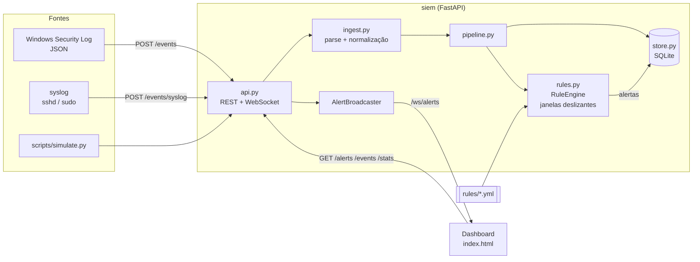

# `>_ siem-dashboard`

**Mini-SIEM em tempo real escrito em Python.** Recebe eventos do *Security Log* do Windows (JSON) e linhas de *syslog*, normaliza tudo em um único modelo, avalia regras de detecção escritas em YAML e envia os alertas por WebSocket para um dashboard web.


```text
$ siem --status
[+] ingest   : Windows Security (4624/4625/4672/4720/4732/4740) + syslog (sshd, sudo)
[+] rules    : 4 regras YAML  -> brute force | login fora do horário | privilégio | novo admin
[+] store    : SQLite (eventos + alertas)
[+] api      : REST + WebSocket /ws/alerts
[+] tests    : pytest + ruff + mypy no CI
```

> Projeto de estudo/portfólio. Não substitui um SIEM de produção (Wazuh, Elastic, Sentinel...) — a ideia é mostrar, em código pequeno e legível, como as peças de um SIEM se encaixam.

---

## O que ele faz

| Etapa | Descrição |
|---|---|
| **Ingestão** | `POST /events` recebe eventos do Windows (objeto ou lista JSON); `POST /events/syslog` recebe linhas de syslog em texto puro. Registros inválidos são rejeitados individualmente, com o índice e o motivo. |
| **Normalização** | Tudo vira um `Event` (pydantic): `timestamp` (UTC), `category`, `host`, `user`, `src_ip`, `target`, `logon_type`... Ex.: o 4625 do Windows e o `Failed password` do sshd viram `category: auth_failure`, então **uma única regra de brute force cobre RDP e SSH**. |
| **Detecção** | Motor de regras com 3 tipos: `match` (evento único), `threshold` (N eventos na janela deslizante) e `off_hours` (fora do horário comercial, com fuso horário). |
| **Armazenamento** | SQLite (`sqlite3` da stdlib). Eventos e alertas persistem entre reinícios. |
| **Alerta** | Cada alerta novo é gravado e enviado na hora para todos os clientes conectados em `/ws/alerts`. |
| **Dashboard** | HTML/JS puro (sem build), tema dark: contadores, eventos recentes, alertas ao vivo com filtro de severidade e *ack* por clique, gráfico de eventos por hora. |

### Regras incluídas (`rules/`)

| Regra | Tipo | Lógica | Severidade | MITRE ATT&CK |
|---|---|---|---|---|
| `brute_force_by_ip` | threshold | ≥ 5 falhas de login (4625 / sshd) do **mesmo IP** em 5 min | critical | T1110 |
| `logon_off_hours` | off_hours | Login interativo/RDP/SSH fora de seg–sex 08:00–19:00 (America/Sao_Paulo) | medium | T1078 |
| `privilege_use_non_admin` | match | 4672 (privilégios especiais) para conta fora da lista de admins | high | T1078 |
| `new_local_admin` | match | 4732 adicionando membro ao grupo local `Administrators`/`Administradores` | high | T1098 |

## Arquitetura



```text
src/siem/
├── models.py     # Event, Alert, Severity, Category (pydantic)
├── ingest.py     # Windows JSON e syslog  ->  Event
├── rules.py      # carga/validação do YAML + RuleEngine
├── store.py      # SQLite: eventos, alertas, filtros, estatísticas
├── pipeline.py   # Event -> store -> engine -> alertas
├── api.py        # FastAPI: rotas REST, WebSocket, dashboard
├── config.py     # configurações via variáveis de ambiente
├── __main__.py   # `python -m siem`
└── static/index.html
```

### Detalhes que importam

- **Janela deslizante pelo horário do evento, não pelo relógio.** O motor usa o `timestamp` de cada evento. Reprocessar logs antigos gera exatamente os mesmos alertas que processar ao vivo, e 5 falhas enviadas de uma vez, mas espalhadas em 10 minutos, **não** disparam a regra de 5 minutos.
- **Borda da janela é inclusiva:** eventos em `t` e `t + window` estão na mesma janela; em `t + window + 1µs`, não. Há testes para os dois lados.
- **Eventos fora de ordem** (atraso menor que a janela) são inseridos na posição correta e contados.
- **Sem tempestade de alertas:** quando o limiar é atingido, os eventos daquela rajada são "consumidos"; um novo alerta exige N eventos *novos*.
- **Memória limitada:** buckets ociosos (sem eventos dentro da janela) são descartados periodicamente.
- **Regras validadas na inicialização:** campo inexistente, fuso inválido, tipo errado ou ID duplicado derrubam o startup com o nome do arquivo — uma regra com erro de digitação não fica desativada em silêncio.
- **Dashboard escapa todo HTML:** usuário e hostname vêm de logs que um atacante controla; renderizar sem escapar seria XSS.

## Como rodar

### Local (Python 3.12)

```bash
git clone https://github.com/Luca-css/siem-dashboard.git
cd siem-dashboard
python -m venv .venv
# Windows: .venv\Scripts\activate   |   Linux/macOS: source .venv/bin/activate
pip install -e ".[dev]"

python -m siem            # http://127.0.0.1:8000  (docs da API em /docs)
```

Em outro terminal, gere tráfego de ataque para ver o dashboard reagir:

```bash
python scripts/simulate.py            # ruído normal + ataque aleatório a cada ~8s
python scripts/simulate.py --once     # cada cenário uma vez e sai
```

O simulador usa só a stdlib e IPs de documentação (RFC 5737). Os cenários são: brute force RDP, brute force SSH via syslog, login RDP às 03h, 4672 para usuário comum e 4732 adicionando um admin local.

> Observação: o ruído de fundo usa o horário atual. Se você rodar a demo de madrugada ou no fim de semana, os logins interativos do ruído também vão gerar alertas de `logon_off_hours` — que é o comportamento correto da regra.

Variáveis de ambiente:

| Variável | Padrão | Descrição |
|---|---|---|
| `SIEM_DB_PATH` | `siem.db` | Arquivo SQLite (`:memory:` para não persistir) |
| `SIEM_RULES_DIR` | `rules` | Diretório com as regras YAML |
| `SIEM_HOST` | `127.0.0.1` | Interface de escuta |
| `SIEM_PORT` | `8000` | Porta |

### Docker

```bash
docker compose up --build                   # só o SIEM em http://localhost:8000
docker compose --profile demo up --build    # SIEM + simulador de ataques
```

A imagem usa `python:3.12-slim`, roda como usuário não-root (`siem`, UID 10001), guarda o banco no volume `siem-data` e monta `./rules` como somente leitura (edite e reinicie o container para recarregar).

### Enviando eventos reais do Windows

O formato aceito é o "achatado" que o PowerShell gera facilmente:

```powershell
$events = Get-WinEvent -FilterHashtable @{LogName='Security'; Id=4624,4625,4672,4732} -MaxEvents 200 |
  ForEach-Object {
    $xml  = [xml]$_.ToXml()
    $data = @{}; foreach ($d in $xml.Event.EventData.Data) { $data[$d.Name] = $d.'#text' }
    [pscustomobject]@{ EventID = $_.Id; TimeCreated = $_.TimeCreated.ToUniversalTime().ToString('o')
                       Computer = $_.MachineName; EventData = $data }
  }
Invoke-RestMethod -Uri http://localhost:8000/events -Method Post -ContentType 'application/json' `
  -Body (ConvertTo-Json @($events) -Depth 4)
```

(Requer PowerShell como Administrador para ler o log de Segurança.) Datas no formato `/Date(ms)/` do PowerShell 5.1 também são aceitas.

## Escrevendo regras

Cada arquivo `rules/*.yml` contém uma regra (ou uma lista delas). Exemplo — a regra de brute force incluída:

```yaml
id: brute_force_by_ip
name: Brute force (failed logons from one IP)
type: threshold            # match | threshold | off_hours
severity: critical         # low | medium | high | critical
mitre: [T1110]
match:
  category: auth_failure   # 4625 do Windows e "Failed password" do sshd
exclude:
  src_ip: ["127.0.0.1", "::1"]
group_by: [src_ip]
threshold: 5
window: 5m                 # 30s, 5m, 1h, 1d ou número de segundos
title: "Brute force: {count} failed logons from {src_ip}"
```

Regras de condição (`match` / `exclude`):

- Chave = campo do `Event` (`event_id`, `category`, `host`, `user`, `src_ip`, `target`, `logon_type`, `source`, `message`).
- Valor único = igualdade; lista = "qualquer um destes".
- Strings são comparadas sem diferenciar maiúsculas/minúsculas e aceitam curingas (`adm.*`, `*$`).
- O evento dispara quando **todas** as condições de `match` batem e **nenhuma** de `exclude`. Campo ausente nunca bate.
- `title` aceita `{campo}` do evento; regras `threshold` também têm `{count}`.

Regra `off_hours` aceita `timezone` (IANA), `start`, `end` (`"HH:MM"`, início inclusivo, fim exclusivo) e `days` (`[mon, tue, ...]`).

## API

| Método | Rota | Descrição |
|---|---|---|
| `GET` | `/health` | Status do serviço e do banco, nº de regras e de clientes WebSocket (503 se o banco falhar) |
| `POST` | `/events` | Ingestão de eventos Windows (objeto ou lista JSON, até 5000 por lote) |
| `POST` | `/events/syslog` | Ingestão de syslog (`text/plain`, uma linha por evento) |
| `GET` | `/events?limit=&offset=` | Eventos mais recentes (ordem de chegada) |
| `GET` | `/alerts` | Alertas, do mais novo ao mais antigo. Filtros: `severity` (repetível), `rule_id`, `host`, `src_ip`, `status`, `since`, `until`; paginação: `limit` (1–500), `offset` |
| `GET` | `/alerts/{id}` | Um alerta |
| `POST` | `/alerts/{id}/ack` | Marca o alerta como reconhecido |
| `GET` | `/stats` | Contadores para o dashboard |
| `GET` | `/rules` | Regras carregadas |
| `WS` | `/ws/alerts` | Envia `{"type": "alert", "data": {...}}` a cada alerta novo |
| `GET` | `/docs` | OpenAPI/Swagger gerado pelo FastAPI |

Resposta da ingestão:

```json
{
  "accepted": 2,
  "rejected": [{"index": 1, "error": "TimeCreated: Field required"}],
  "alerts": []
}
```

Se **todos** os registros forem inválidos a resposta é `422`, para que um coletor quebrado seja percebido.

Exemplo de consulta:

```bash
curl "http://localhost:8000/alerts?severity=critical&severity=high&since=2026-11-11T00:00:00Z&limit=20"
```

## Testes e qualidade

```bash
pytest                               # testes
pytest --cov --cov-report=term-missing
ruff check . && ruff format --check .
mypy                                 # modo strict
```

Os testes cobrem: bordas da janela deslizante (exatamente igual à janela / 1µs acima), expiração, eventos fora de ordem, consumo da rajada, grupos independentes, limites do horário comercial com fuso, curingas e exclusões, validação das regras YAML, parsers de Windows e syslog (incluindo virada de ano do RFC 3164), API REST (filtros, paginação, erros, persistência após reinício) e o WebSocket (broadcast para múltiplos clientes e remoção de clientes desconectados).

O CI (`.github/workflows/ci.yml`) roda ruff, mypy e pytest a cada push e pull request.

## Limitações conhecidas

- O estado das janelas deslizantes fica em memória: reiniciar o processo zera contagens em andamento (alertas já gerados ficam no banco).
- Processo único: o lock da pipeline e o SQLite não foram feitos para várias réplicas.
- Sem autenticação na API — rode em rede confiável ou atrás de um proxy com auth.
- Regras são carregadas no startup; mudanças exigem reinício.
- Horário comercial que atravessa a meia-noite (ex.: 22h–06h) não é suportado.
- Timestamps de syslog RFC 3164 (sem fuso) são assumidos como UTC.

## Licença

[MIT](LICENSE) © 2026 Lucas Santos
